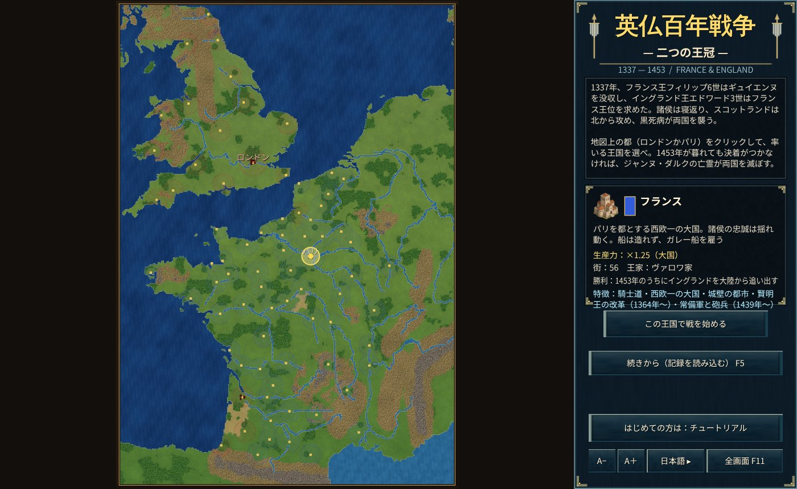

# 英仏百年戦争 — 二つの王冠（yyFranceAndEngland）

Rust で作った Age of Empires 風のリアルタイムストラテジーです。**ブラウザ版**と **Windows 版**を、同じリポジトリの同じゲーム本体から作ります。
[yyMongolia（モンゴル帝国）](https://github.com/ykwyuta/yyMongolia) のシステム（シミュレーション・AI・UI・描画層・記録）を土台に、
舞台を 1337〜1453 年のフランスとイングランドに移し、二つの王国・諸侯・兵種・英雄・史実の出来事を作り直しました。

- **ブラウザ版**：WebAssembly にコンパイルし、WebGL2 と Canvas2D で描画する。外部クレートは使わない。静的サイトとして Cloudflare（Workers の静的アセット／Pages）で公開できる。
- **Windows 版**：Direct3D11 / Direct2D / DirectWrite で描画する。`windows` クレート（Win32 API バインディング）だけで描画・入力を作る。

**ドキュメント**：紹介とユーザーガイド（[日本語](docs/ja/introduction.md)・[English](docs/en/introduction.md)・[中文](docs/zh/introduction.md)）。



## 遊ぶ・ビルドする

```
bash build.sh                      # Rust が無ければ rustup で導入し、dist/ に静的サイトを出力
cd dist && python3 -m http.server 8000
```

ブラウザで http://localhost:8000/ を開く。

### Windows 版

```
cargo run --release --bin yyfranceandengland-win
```

- 表示言語は `%APPDATA%\yyfranceandengland\settings.txt` に保存する。
- 記録は `%APPDATA%\yyfranceandengland\saves\slot{N}.yyfesav`。ブラウザ版と同じ形式なので、互いに持ち運べる。

### Cloudflare への公開

- **Workers（静的アセット）**：`bash build.sh && npx wrangler deploy`（設定は `wrangler.toml`）
- **Pages／Workers Builds（Git 連携）**：ビルドコマンド `npm run build`（中身は `bash build.sh`）、出力ディレクトリ `dist`

## ゲームの特徴

- **舞台**：1337年（フィリップ6世のギュイエンヌ没収とエドワード3世の王位要求）〜1453年（カスティヨンの戦い）。ブリテン島南部からピレネーまで、海岸線・河川（セーヌ・ロワール・ガロンヌ・ローヌ・テムズなど）は Natural Earth（パブリックドメイン）の 1:10m データから作り、ピレネー・アルプス・中央山地・ペナイン・ウェールズの山地、ランドの荒れ地を再現した。
- **二つの王国**：イングランドとフランスだけが国。スコットランドは国ではなく、史実の時期（ネヴィルズ・クロス、オッターバーン、ホミルドン・ヒル、1417年の「愚かな侵攻」）にイングランドの北へ攻め込み、1419年・1424年にはフランスに兵を送る。
- **街は築けない・村は建てられる**：ロンドン・パリ・ルーアン・ボルドー・オルレアン・ランスなど76の主要な街が最初からあり、新しい街は築けない。民は「村」を建てられ、村は糧を生み、民・兵の上限を上げる。
- **略奪**：敵の村を壊すと略奪になり、糧・木・鉄・金貨を奪う。イングランドは「騎行（シュヴォシェ）」で多く奪う。スコットランド軍や大傭兵団も村を荒らす。
- **諸侯の寝返りと同盟**：街にはそれぞれ諸侯がいる（フランドル、ブルターニュ、モンフォール派、ナバラ王、ブルゴーニュ公、ガスコーニュ諸侯、パリ市民、シャンパーニュの諸都市、ウェールズ、ギュイエンヌの都市）。史実の年に諸侯が寝返ったり同盟したりすると、その街は相手の王に付く。ジャンヌ・ダルクが生きていれば、1429年のランスの戴冠でシャンパーニュの街が王太子に城門を開く。
- **英雄**：英雄システム（召喚）はない。代わりにエドワード3世・黒太子・ランカスター公・ヘンリー5世・タルボット・デュ・ゲクラン・クリッソン・ジャンヌ・ダルク・ラ・イール・デュノワ・リッシュモン・ジャン・ビュローなど実在の英雄25人が、史実の年に兵として現れる。英雄のそばの兵は攻撃が上がる。英雄は史実の没年を越えて生きられない。
- **身代金**：討たれた英雄は捕らえられ、捕らえた国は相手国に身代金（金貨）を請求できる。相手が払えば英雄は戻る。ジャンヌ・ダルクだけは身代金では救えない。
- **船**：イングランドは港でコグ船を造れる。フランスは船を造れず、イタリアの都市（ジェノヴァ）から傭兵としてガレー船を雇う（1369年からはカスティーリャのガレー船も）。海の向こうへの移動を命じれば、船が自動で往復して兵を運ぶ。
- **兵種**：ロングボウ兵・下馬重装兵・騎乗弓兵・騎士・コグ船（イングランド）、槍兵・弩兵・フランス騎士・勅令隊（1445年〜）・フラン・アルシェ（1448年〜）・王の砲兵（1436年〜）（フランス）、ボンバード（両国、1375年〜）、ジェノヴァ弩兵・ガレー船・スコットランド槍兵・傭兵団（傭兵・国ではない兵）。
- **史実の出来事（72件）**：スロイス、クレシー、黒死病、ジャックリー、ブレティニー条約、シャルル5世の改革、ワット・タイラーの乱、シャルル6世の狂気、ランカスター家の簒奪、グリンドゥールの反乱、アジャンクール、トロワ条約、ランスの戴冠、アラスの和約、パリの回復、勅令隊、フージェールの略奪、ボルドーの蜂起、カスティヨンなど。休戦の申し入れは受けるか退けるか選べる。
- **勝利**：フランスは1453年のうちに大陸からイングランドを追い出せば勝利。イングランドはフランスを占領し尽くせば勝利。どちらも果たせなければ、ジャンヌ・ダルクの亡霊が天使を引き連れて両国を滅ぼす。
- **大軍の編成と進軍**：兵数上限は「60＋街数＋村数×3」（最大200人、継承分は別枠）。新規対局は両国とも都に兵12人・民8人、イングランドはボルドーにも兵16人・民6人を配置し、初期資源は糧800・木650・鉄400。AIは通常6〜16人で出撃し、4〜10人ずつ増援する。出撃間隔は好戦性に応じて約3〜7秒。戦時は働き手の数に合わせて陸地ごとに最大六つの兵営で並行訓練し、イングランドは輸送船を最大8隻まで整える。休戦期間と資源・兵数の上限は守る。
- **英軍の大陸遠征**：大陸の兵営の建設・訓練を優先し、働き手も大陸を本土のおよそ2倍の人数へ育てる。歩兵・弓兵を多めに補充し、大陸では12〜24人を出撃の目安、8〜16人を増援の目安とする。侵入者には近くの4〜24人を守備に回し、残りの主力は攻勢を続ける。
- **AIの兵站**：田は働き手が集まる街の近くに建て、食糧が乏しければ農業への配分を増やす。採集者は余っている資源から不足している資源へ少しずつ配置し直す。民の上限は最大100人。
- そのほか、yyMongolia と同じく、少数精鋭（訓練・教化）、維持費、兵⇔民の転換、建設の予約、要塞、戦場の霧、指揮中の一時停止、歴史（F3）、交易（F4）、記録（F5）、チュートリアル（フランスで開始）、日本語・英語・中国語の表示、タッチ操作に対応。

## 構成

| ファイル | 内容 |
|---|---|
| `src/geo.rs` | 地図の範囲・地形生成、国家・諸侯・街のデータ |
| `src/geodata.rs` | 海岸線・湖・河川（`tools/geoprep.py` が Natural Earth から生成） |
| `src/world.rs` | シミュレーション：ユニット、建物（街・村）、経済、戦闘、外交、勝敗 |
| `src/world/units.rs` | 兵種の表と国ごとの兵種（年代で増える兵種） |
| `src/world/naval.rs` | 船：乗船・上陸・自動の渡海 |
| `src/world/conquest.rs` | 村の略奪、街の名前、諸侯の寝返り・同盟による街の離脱、遷都 |
| `src/world/history.rs` | 史実年表（`tools/gendata.py` が生成）とその効果 |
| `src/world/traits.rs` | 国ごとの史実に基づく特徴 |
| `src/world/heroes.rs` | 史実の英雄の登場・没年・捕縛と身代金 |
| `src/world/descent.rs` | ジャンヌ・ダルクの亡霊と天使の軍勢 |
| `src/world/trade.rs` | 交易：商人・遠方の商人、スコットランド軍・ジェノヴァの傭兵とガレー船・大傭兵団 |
| `src/world/tests.rs` | 世界のテスト（地理・諸侯・英雄と身代金・勝敗・亡霊・渡海・全 AI のシミュレーション） |
| `src/i18n.rs` | データの英語・中国語訳（`tools/gendata.py` が生成） |
| `src/ai.rs` | コンピュータの王国（陸地ごとの攻撃、騎行、港と船、傭兵） |
| `src/game.rs` ほか `src/game/*` | 画面、入力、HUD、外交・ヘルプ・歴史・交易・英雄と捕虜・記録・チュートリアル |
| `src/art.rs`・`src/art/historical.rs` | アイコン・写本風UI・百年戦争専用の兵、建物、船、大砲、25人の英雄の絵 |
| `src/web.rs`・`src/gfx.rs`・`src/platform.rs`・`web/` | ブラウザ版 |
| `src/main.rs`・`src/win/*` | Windows 版 |

## データの作り直し

```
python3 -I tools/geoprep.py <Natural Earth の 10m geojson のあるディレクトリ> src/geodata.rs
python3 tools/gendata.py           # 史実年表と訳の辞書を作り直す
```

## テスト

```
cargo test --release --lib -- --skip long_sim              # 単体テスト
SIM_YEARS=120 cargo test --release long_sim -- --nocapture  # 両国 AI で1337〜1457年をヘッドレスで回す
```

## 出典

地図の海岸線・湖・河川は [Natural Earth](https://www.naturalearthdata.com/)（パブリックドメイン）の 1:10m データを簡略化したもの。
ゲームエンジンの土台は [yyMongolia](https://github.com/ykwyuta/yyMongolia) のもの。兵・建物・地形・船・大砲・英雄は、内蔵画像生成ツールで1337〜1453年の英仏を想定して新規制作した専用アセットを使う。生成イラストは人物・装備・紋章の解釈であり、肖像や個々の紋章の厳密な復元ではない。

原画・生成プロンプト・確認用一覧は `assets/hundred-years/`。`python tools/import_hundred_years_art.py` で透過PNGからゲーム用BGRA、共通アイコン、起動画面の画像を再生成する。旧 `assets/period/` は資料として残すが実行時には読み込まない。甲冑の年代の参考：[The Met — Visored Bascinet, 1375–1400](https://www.metmuseum.org/art/collection/search/21986)。


## ブラウザ版のキャッシュ更新

ゲーム内のヘルプ（F1）の「キャッシュを更新して再読み込み」で、セーブデータと設定を残したままゲームのキャッシュを更新して再読み込みできます。未保存の進行は戻らないため、必要なら先にF5の記録画面で保存してください。保存処理中は完了を待ち、保存失敗やメモリ上だけの記録がある場合は再読み込みを中止します。通信に失敗した場合も対局画面に留まります。 ゲームを読み込めなかったときは、エラー画面からも更新できます。

確認テスト：`node tools/test-browser-recovery.cjs`
