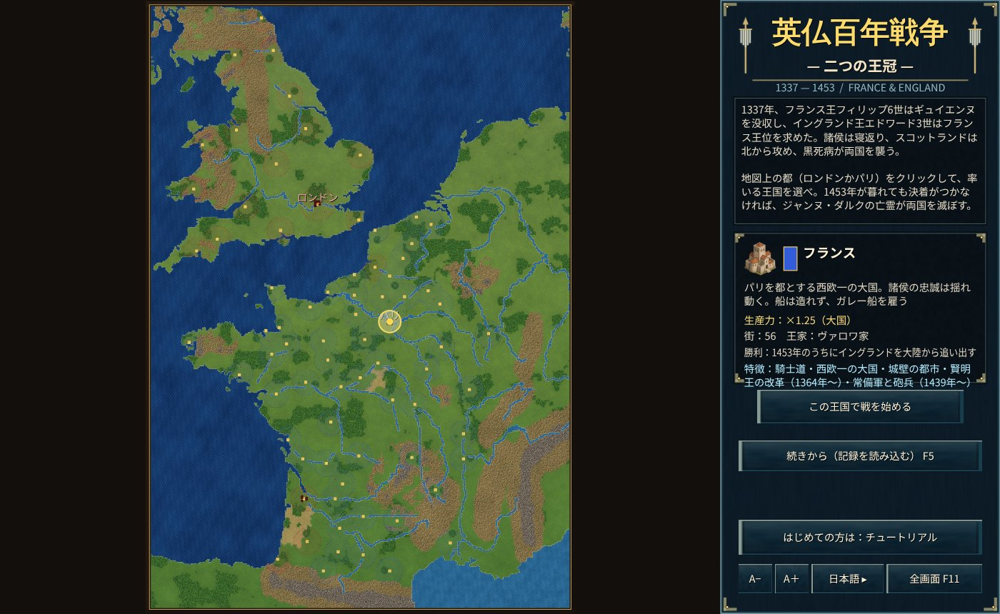
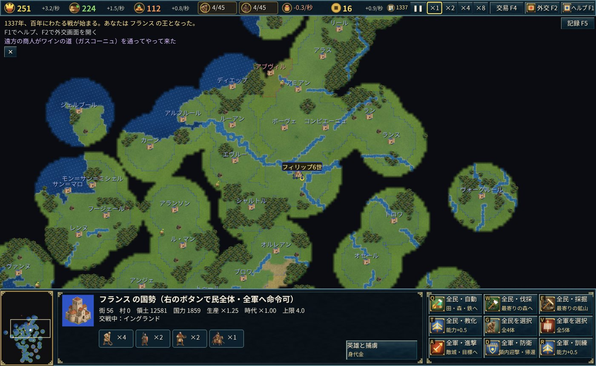

# The Hundred Years' War — Two Crowns

1337: Philip VI of France confiscates Guyenne, and Edward III of England claims the French crown.
Lords change sides, the Scots strike from the north, and the Black Death ravages both kingdoms...

A real-time strategy game set in France and England from 1337 to 1453. Choose England or France and settle the war before the end of 1453, the year the Hundred Years' War historically ended.

## Victory and defeat

- **France** wins by removing every English town from the Continent (outside Great Britain) before the end of 1453.
- **England** wins by taking every French town.
- **If neither happens**, the ghost of Joan of Arc appears with a host of angels and destroys both kingdoms within 5 years (no one can harm the angels).

## Key points

- **Towns and villages**: 76 great towns (London, Paris, Rouen, Bordeaux, Orléans...) exist from the start and no new towns can be founded. Workers can build villages inside your territory: they produce food, receive resources and raise your worker and soldier limits.
- **Plunder**: destroy an enemy village to plunder its food, wood, iron and gold (England takes more on the chevauchée).
- **Lords change sides**: towns belong to lords — Flanders, Brittany, the King of Navarre, the Duke of Burgundy, the Gascon lords, the citizens of Paris, the towns of Champagne, Wales... When a lord defects or makes an alliance in the historical year, those towns go over to the other king (Flanders 1340, Burgundy 1419, the Treaty of Troyes 1420, the Congress of Arras 1435, and more).
- **Heroes**: 25 real heroes — Edward III, the Black Prince, Henry V, Talbot, Du Guesclin, Joan of Arc, Dunois, Richemont... — appear as units in their historical years. Troops near a hero attack harder. No hero can live past their historical death.
- **Ransom**: a defeated hero is captured and the captor can demand a ransom (Heroes screen, H). Only Joan of Arc cannot be ransomed.
- **Ships**: England builds cogs at a Harbor. France cannot build ships and hires Genoese galleys (Castilian ones too from 1369) on the Trade screen (F4).
- **Scotland** is not a kingdom in the game, but in its historical years it invades the north of England, and in 1419 and 1424 it sends troops to France.

See the in-game Help (F1) and the Tutorial (as France) for the controls.
