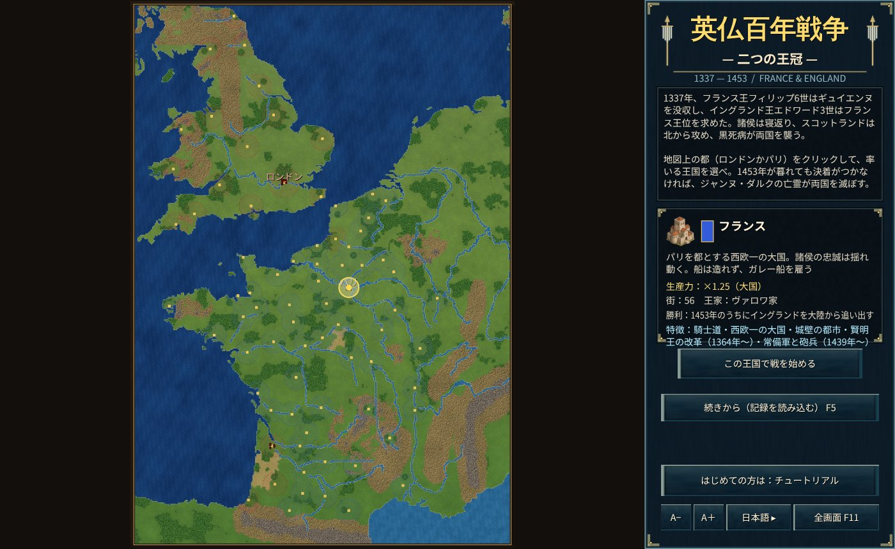
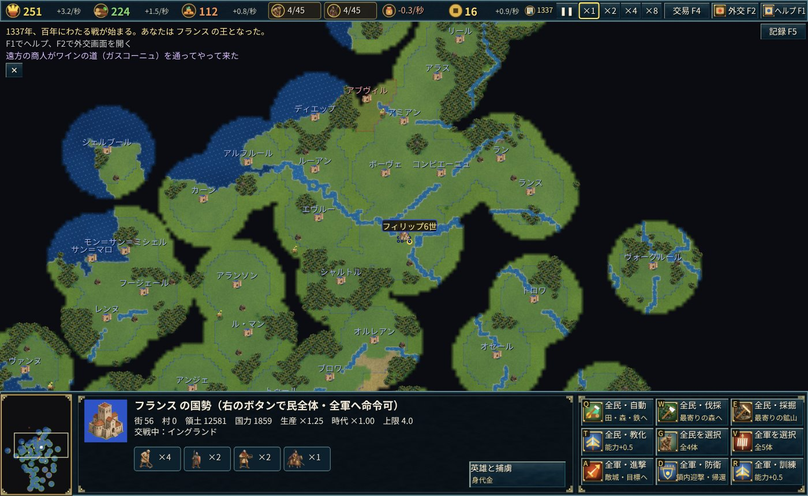

# 英仏百年戦争 — 二つの王冠

1337年、フランス王フィリップ6世はギュイエンヌを没収し、イングランド王エドワード3世はフランス王位を求めた。
諸侯は寝返り、スコットランドは北から攻め、黒死病が両国を襲う——。

本作は、1337〜1453年のフランスとイングランドを舞台にしたリアルタイムストラテジーです。イングランドかフランスを選び、史実で百年戦争が終わった1453年のうちに決着をつけることを目指します。

## 勝利と敗北

- **フランス**：1453年が暮れるまでに、大陸（ブリテン島の外）からイングランドの街をすべて取り除けば勝利。
- **イングランド**：フランスの街をすべて取れば勝利。
- **どちらも果たせなければ**：ジャンヌ・ダルクの亡霊が天使の軍勢を引き連れて現れ、5年のうちに両国を滅ぼします（天使は誰にも傷つけられません）。

## 遊び方の要点

- **街と村**：ロンドン・パリ・ルーアン・ボルドー・オルレアンなど76の主要な街が最初からあり、新しく築くことはできません。民は自国領内に「村」を建てられます。村は糧を生み、資源の運び先になり、民・兵の上限を上げます。
- **略奪**：敵の村を攻めて壊すと略奪になり、糧・木・鉄・金貨を奪えます（イングランドは騎行で多く奪う）。
- **諸侯の寝返りと同盟**：街にはフランドル・ブルターニュ・ナバラ王・ブルゴーニュ公・ガスコーニュ諸侯・パリ市民・シャンパーニュの諸都市・ウェールズなどの諸侯がいます。史実の年に諸侯が寝返ったり同盟したりすると、その街はもう一方の王に付きます（1340年のフランドルの同盟、1419年のブルゴーニュ公の同盟、1420年のトロワ条約、1435年のアラスの和約など）。
- **英雄**：エドワード3世、黒太子、ヘンリー5世、タルボット、デュ・ゲクラン、ジャンヌ・ダルク、デュノワ、リッシュモンなど25人の英雄が史実の年に兵として現れます。英雄のそばの兵は攻撃が上がります。英雄は史実の没年を越えて生きられません。
- **身代金**：討たれた英雄は捕らえられ、捕らえた国は相手国に身代金を請求できます（「英雄と捕虜」H）。ジャンヌ・ダルクだけは身代金で救えません。
- **船**：イングランドは港でコグ船を造れます。フランスは船を造れず、交易画面（F4）でジェノヴァ（1369年からはカスティーリャも）のガレー船を雇います。
- **スコットランド**：国ではありませんが、史実の時期にイングランドの北へ攻め込み、1419年と1424年にはフランスに兵を送ります。
- **兵種**：ロングボウ兵・下馬重装兵・騎乗弓兵・騎士・コグ船（イングランド）、槍兵・弩兵・フランス騎士・勅令隊・フラン・アルシェ・王の砲兵（フランス）、ボンバード（両国）。

操作はゲーム内のヘルプ（F1）とチュートリアル（フランスで開始）を参照。

## Windows 版

同じゲームを Windows のアプリとしても遊べます（Direct3D11 / Direct2D で描画）。`cargo run --release --bin yyfranceandengland-win` で起動するか、GitHub Actions の成果物 `yyfranceandengland-windows` の `yyfranceandengland-win.exe` を実行します。記録は `%APPDATA%\yyfranceandengland\saves` に保存され、ブラウザ版と同じ形式なので書き出して持ち運べます。
