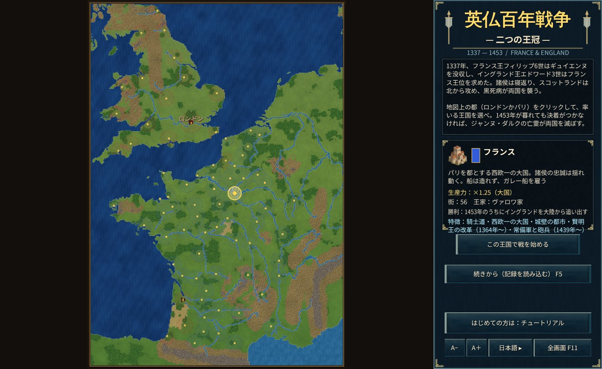
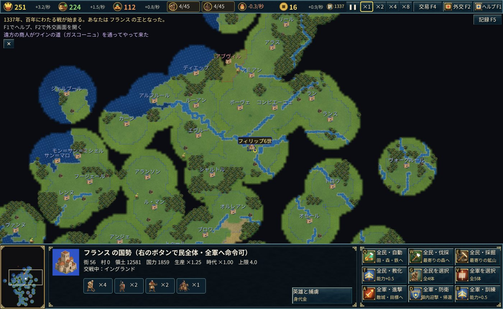

# 英法百年战争 — 两顶王冠

1337年，法王腓力六世没收吉耶讷，英王爱德华三世要求法兰西王位。
诸侯倒戈，苏格兰自北来攻，黑死病席卷两国——。

本作是以1337〜1453年的法兰西与英格兰为舞台的即时战略游戏。选择英格兰或法兰西，在史实中百年战争结束的1453年之内分出胜负。

## 胜利与失败

- **法兰西**：在1453年年底之前，将英格兰的城镇全部逐出大陆（大不列颠岛以外）即获胜。
- **英格兰**：夺取法兰西全部城镇即获胜。
- **若双方都未能达成**：贞德的亡灵将率领天使大军现身，5年之内毁灭两国（天使无人能伤）。

## 玩法要点

- **城镇与村庄**：伦敦、巴黎、鲁昂、波尔多、奥尔良等76座主要城镇一开始就存在，无法新建。民可在己方领土内建造村庄，村庄产粮、接收资源，并提高民与兵的上限。
- **劫掠**：摧毁敌方村庄即可劫掠粮、木、铁与金币（英格兰在骑行中夺得更多）。
- **诸侯倒戈与结盟**：城镇各有领主——佛兰德斯、布列塔尼、纳瓦拉国王、勃艮第公爵、加斯科涅诸侯、巴黎市民、香槟诸城、威尔士等。诸侯在史实年份倒戈或结盟时，其城镇便归附另一位国王（1340年佛兰德斯同盟、1419年勃艮第同盟、1420年特鲁瓦条约、1435年阿拉斯和约等）。
- **英雄**：爱德华三世、黑太子、亨利五世、塔尔博特、迪盖克兰、贞德、迪努瓦、里什蒙等25位真实英雄会在史实年份作为单位登场。英雄身边的士兵攻击提升。英雄无法活过史实卒年。
- **赎金**：被击败的英雄会被俘，俘获方可向对方索要赎金（“英雄与俘虏”H）。唯有贞德无法用赎金赎回。
- **船**：英格兰可在港口建造柯克船。法兰西无法造船，需在贸易界面（F4）雇佣热那亚（1369年起还有卡斯蒂利亚）的桨帆船。
- **苏格兰**：本作中不作为国家，但会在史实时期入侵英格兰北部，并于1419年与1424年派兵援助法兰西。

操作请参阅游戏内帮助（F1）与教程（以法兰西开始）。
